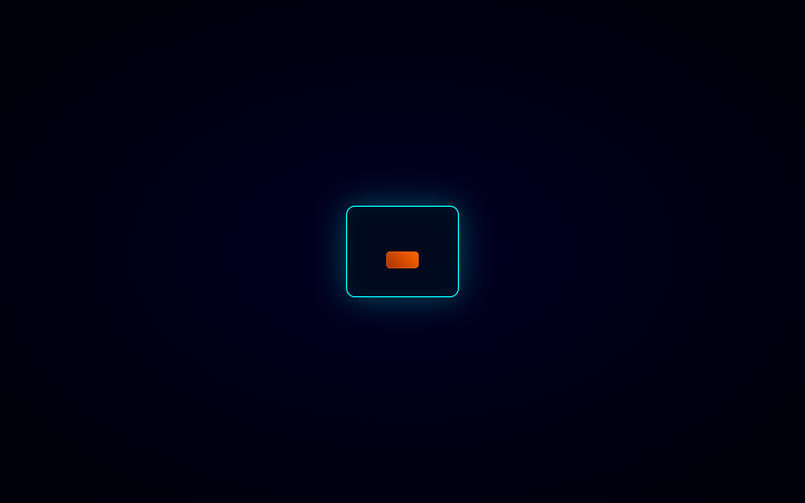
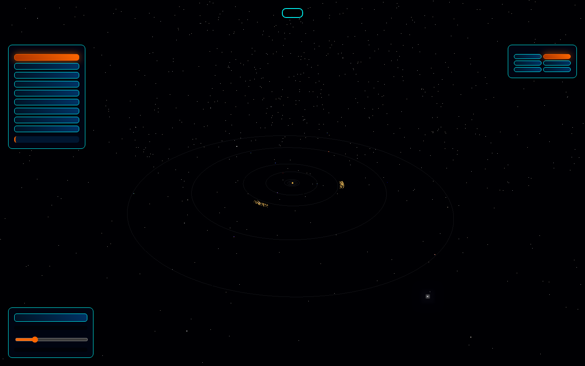
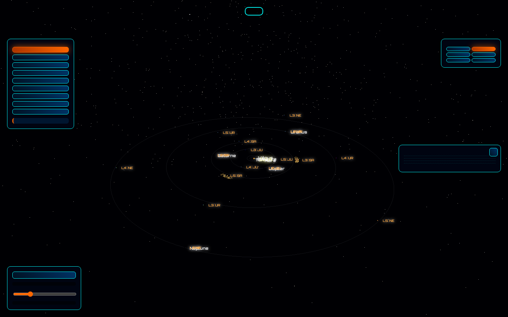
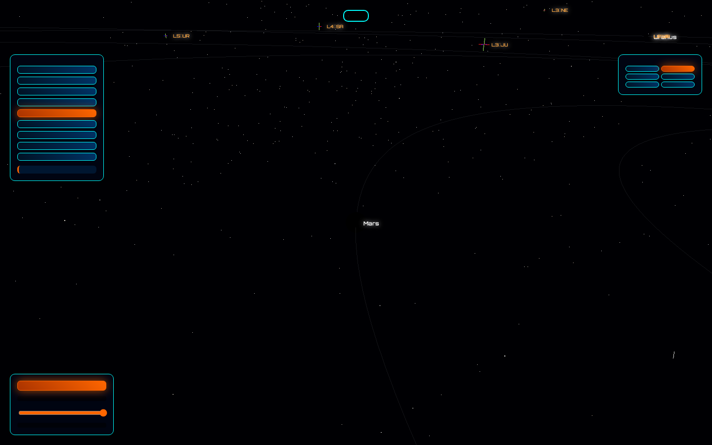

# 🌌 Lagrange — Le Système Solaire et ses Points de Lagrange

Une simulation 3D interactive du système solaire dont la signature est de pouvoir **observer depuis n'importe quel référentiel** — le Soleil ou n'importe quelle planète — avec une mécanique képlérienne authentique et les points de Lagrange rendus *jouables*.


## ✨ Ce que vous y trouvez

- **Physique képlérienne réelle** : orbites elliptiques avec excentricité et inclinaison, équation de Kepler résolue par Newton, date simulée affichée, vitesse réglable (0 à 4×)
- **9 référentiels** : héliocentrique ou centré sur chaque planète, chacun avec une légende pédagogique qui explique *ce que vous observez* (mouvement rétrograde apparent, jour sidéral de Vénus…)
- **Points de Lagrange L1 à L5** pour les géantes, cliquables, avec explications (SOHO à L1, James-Webb à L2, troyens à L4/L5)
- **Nuages de troyens** : 240 astéroïdes piégés aux L4/L5 de Jupiter
- **Fiches encyclopédiques** au clic sur n'importe quel corps céleste
- **Pluie d'astéroïdes** avec gravité du Soleil et des planètes, traînées configurables ; 40 % naissent candidats troyens près de L4/L5 de Jupiter et s'y installent en libration (physique réelle : GM dérivé de Kepler, ratios de masse exacts, intégration en jours simulés)
- **13 missions spatiales historiques** (Voyager, Pioneer, New Horizons, Apollo 11, JWST…) : trajectoires, survols datés et fiches
- **Tour automatique cinématique** : visite guidée Soleil → planètes avec transitions fluides
- **Backend professionalisé** : app factory, config dev/prod avec headers de sécurité, endpoint `/health`, tests pytest
- **Effet waou** : shader solaire animé, bloom, Terre de nuit avec villes illuminées, étoiles colorées
- **Écran de lancement** façon salle de contrôle, raccourcis clavier (1–9 = référentiels, Espace = pause)

## 🖼️ Aperçus

| Écran de lancement | Référentiel Soleil |
|---|---|
|  |  |

| Fiche encyclopédique | Troyens de Jupiter |
|---|---|
|  |  |

## 🚀 Démarrage

Sur le MBP, l'environnement est déjà prêt (`.venv`, Python 3.13) :

```bash
cd ~/Applications-JB/lagrange
.venv/bin/python app.py              # dev (debug, rechargement auto)
FLASK_ENV=production .venv/bin/python app.py   # en-têtes de sécurité renforcés
```

Puis ouvrez http://127.0.0.1:5055. **Port 5055 et non 5000** : sur macOS, le 5000 est
pris par le récepteur AirPlay. Le port se règle par `FLASK_PORT` dans `.env`.

Sur une machine neuve : `python -m venv .venv && VIRTUAL_ENV=$PWD/.venv poetry install --no-root`
(le `VIRTUAL_ENV` explicite évite que Poetry n'installe dans un autre Python déjà actif), puis un `.env` avec `SECRET_KEY`. Les variables lues sont
dans `config.py` : `FLASK_ENV`, `FLASK_HOST`, `FLASK_PORT`, `SECRET_KEY`, `APP_NAME`,
`LOG_LEVEL`.

three.js est embarqué dans `static/vendor/` : aucun CDN pour le code. Seule la police
Orbitron vient encore de Google Fonts (voir `ROADMAP.md`).

## 📍 Où elle vit

- **Le code** : ce dépôt, GitHub `jbdfdb/lagrange`, branche `main`. Clone de travail sur le
  MBP, `~/Applications-JB/lagrange`.
- **Pas de base, pas de données** : tout le contenu (orbites, fiches, missions) est dans
  `static/js/data.js` et `missions.js`, donc dans git.
- **Le seul secret**, `.env`, est sauvegardé par l'archive de configuration chiffrée du MBP
  (chaque jour à 13 h 20, vers le datacenter du Fedora).
- **Plus servie en ligne** depuis le 29/10/2026 : elle tournait sur le VPS CX32 sous
  `space.digitoptimmo.fr`, retirée en la rapatriant ici. La recette pour la remettre sur
  un VPS est dans Architecture-JB, §4.10.

## 🗂️ Architecture

```
app.py                    # Flask : app factory, deux routes (/ et /health), en-têtes de sécurité
config.py                 # configuration dev / prod / test, lue dans .env
templates/index.html      # markup de l'interface (aucune variable : la page est statique)
static/style.css          # thème cyan/orange
static/lagrange.js        # orchestrateur : boucle d'animation, interactions, caméra
static/js/
  data.js                 # éléments orbitaux + contenu encyclopédique français
  physics.js              # Kepler (positions, équation de Kepler, points de Lagrange)
  scene.js                # objets three.js (soleil à shader, planètes, orbites, troyens)
  asteroids.js            # pluie d'astéroïdes : gravité, captures aux L4/L5
  missions.js             # 13 missions spatiales : trajectoires, survols, fiches
  voyage.js               # tour automatique cinématique
  ui.js                   # labels DOM, panneaux, fiches
static/vendor/            # three.js 0.170 + addons (bloom, OrbitControls)
docs/screenshots/         # aperçus du README
```

## ✅ Tests

```bash
node tests/physics.test.mjs      # 9 tests — Kepler : périodes, focalisation, loi des aires, L4/L5
node tests/asteroids.test.mjs    # 12 tests — pluie : isotropie, coquille, capture troyenne prouvée
.venv/bin/python -m pytest -q    # 12 tests — serveur : routes, en-têtes, configuration, modules statiques
```

Tous verts le 31/10/2026 (Node 24, Python 3.13.1).

## 🎮 Prise en main

- **Clic** sur un astre ou un point de Lagrange → fiche + focus caméra
- **1–9** : référentiels (1=Soleil, 2=Mercure, 3=Vénus, 4=Terre, 5=Mars, 6=Jupiter, 7=Saturne, 8=Uranus, 9=Neptune) · **Espace** : pause · **Échap** : fermer la fiche
- Les étiquettes se placent sous chaque astre, à une distance qui suit le zoom (jamais superposées au disque ni au halo)
- **Slider de vitesse** : de pause figée à 4× (≈ 3 jours simulés par seconde à 1×)

## 🧭 La suite

État, chantiers et idées : [`ROADMAP.md`](ROADMAP.md).
