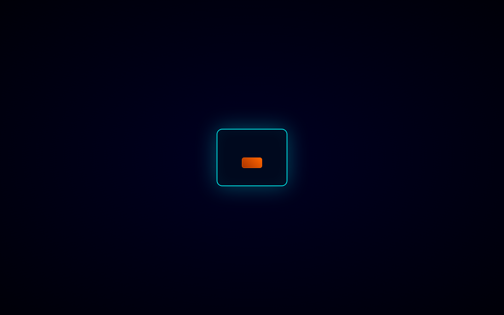
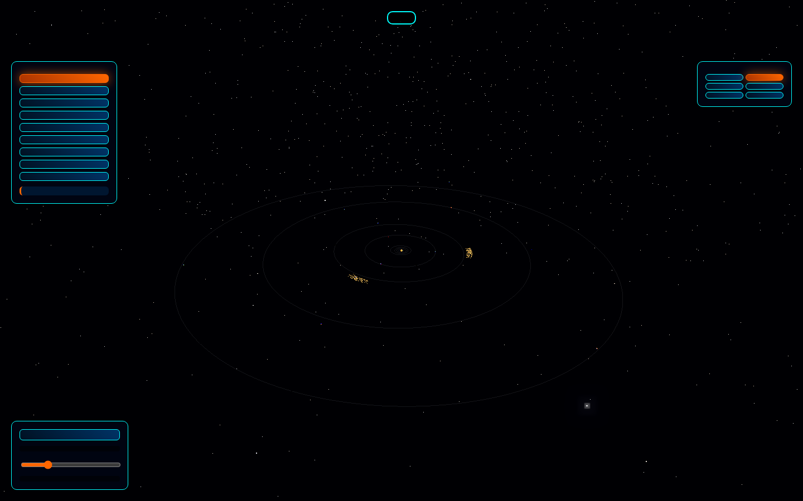
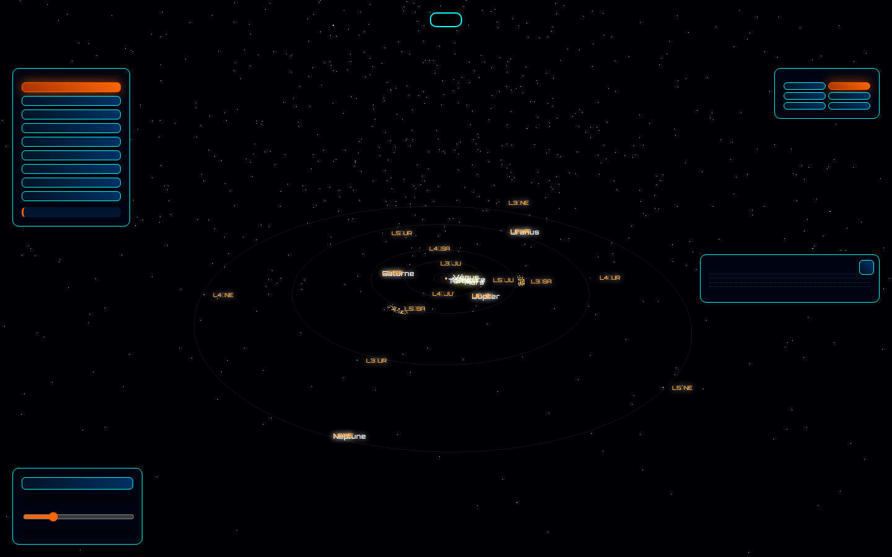
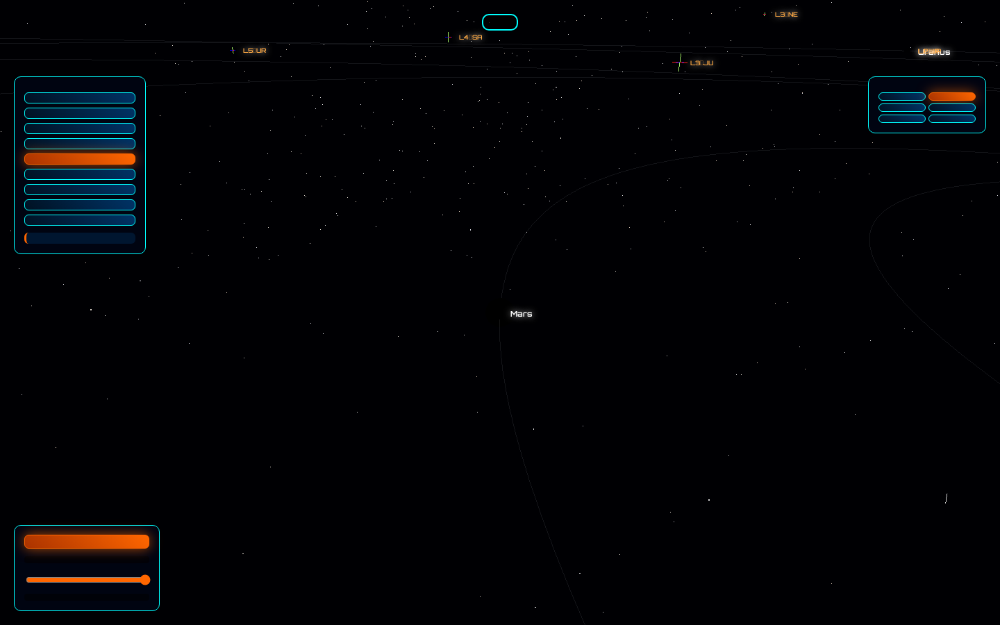

# 🌌 Lagrange — Le Système Solaire et ses Points de Lagrange

Une simulation 3D interactive du système solaire dont la signature est de pouvoir **observer depuis n'importe quel référentiel** — le Soleil ou n'importe quelle planète — avec une mécanique képlérienne authentique et les points de Lagrange rendus *jouables*.


## ✨ Ce que vous y trouvez

- **Physique képlérienne réelle** : orbites elliptiques avec excentricité et inclinaison, équation de Kepler résolue par Newton, date simulée affichée, vitesse réglable (0 à 4×)
- **9 référentiels** : héliocentrique ou centré sur chaque planète, chacun avec une légende pédagogique qui explique *ce que vous observez* (mouvement rétrograde apparent, jour sidéral de Vénus…)
- **Points de Lagrange L1 à L5** pour les géantes, cliquables, avec explications (SOHO à L1, James-Webb à L2, troyens à L4/L5)
- **Nuages de troyens** : 240 astéroïdes piégés aux L4/L5 de Jupiter
- **Fiches encyclopédiques** au clic sur n'importe quel corps céleste
- **Pluie d'astéroïdes** avec gravité du Soleil et des planètes, traînées configurables ; 40 % naissent candidats troyens près de L4/L5 de Jupiter et s'y installent en libration (physique réelle : GM dérivé de Kepler, ratios de masse exacts, intégration en jours simulés)
- **13 missions spatiales historiques** (Voyager, Pioneer, New Horizons, Apollo 11, JWST…) : trajectoires, survols datés et fiches
- **Tour automatique cinématique** : visite guidée Soleil → planètes avec transitions fluides
- **Backend professionalisé** : app factory, config dev/prod avec headers de sécurité, endpoint `/health`, tests pytest
- **Effet waou** : shader solaire animé, bloom, Terre de nuit avec villes illuminées, étoiles colorées
- **Écran de lancement** façon salle de contrôle, raccourcis clavier (1–9 = référentiels, Espace = pause)

## 🖼️ Aperçus

| Écran de lancement | Référentiel Soleil |
|---|---|
|  |  |

| Fiche encyclopédique | Troyens de Jupiter |
|---|---|
|  |  |

## 🚀 Démarrage

```bash
pip install flask python-dotenv
python app.py        # dev (debug auto-reload)
FLASK_ENV=production python app.py   # prod (headers sécurité renforcés)
```

Puis ouvrez http://127.0.0.1:5000 — tout est statique, aucun CDN requis (three.js est vendored dans `static/vendor/`).

## 🗂️ Architecture

```
app.py                    # serveur Flask minimal (une route)
templates/index.html      # markup de l'interface
static/style.css          # thème cyan/orange
static/lagrange.js        # orchestrateur : boucle d'animation, interactions, caméra
static/js/
  data.js                 # éléments orbitaux + contenu encyclopédique français
  physics.js              # Kepler (positions, équation de Kepler, points de Lagrange)
  scene.js                # objets three.js (soleil à shader, planètes, orbites, troyens)
  ui.js                   # labels DOM, panneaux, fiches
static/vendor/            # three.js 0.170 + addons (bloom, OrbitControls)
tests/physics.test.mjs    # 9 tests unitaires node (sans framework)
```

```bash
node tests/physics.test.mjs    # Kepler : périodes, focalisation, loi des aires, L4/L5
node tests/asteroids.test.mjs  # pluie : isotropie, coquille, capture troyenne prouvée
pytest tests/                  # serveur : routes, headers sécurité, modules statiques
```

## 🎮 Prise en main

- **Clic** sur un astre ou un point de Lagrange → fiche + focus caméra
- **1–9** : référentiels (1=Soleil, 2=Mercure, 3=Vénus, 4=Terre, 5=Mars, 6=Jupiter, 7=Saturne, 8=Uranus, 9=Neptune) · **Espace** : pause · **Échap** : fermer la fiche
- Les étiquettes se placent sous chaque astre, à une distance qui suit le zoom (jamais superposées au disque ni au halo)
- **Slider de vitesse** : de pause figée à 4× (≈ 3 jours simulés par seconde à 1×)

## 🧭 Idées pour la suite

- Mode « JWST » : placer un télescope à L2 à la main
- Potentiel effectif en contour coloré pour visualiser les puits de Lagrange
- Tour guidé narratif « De Copernic à Lagrange »
